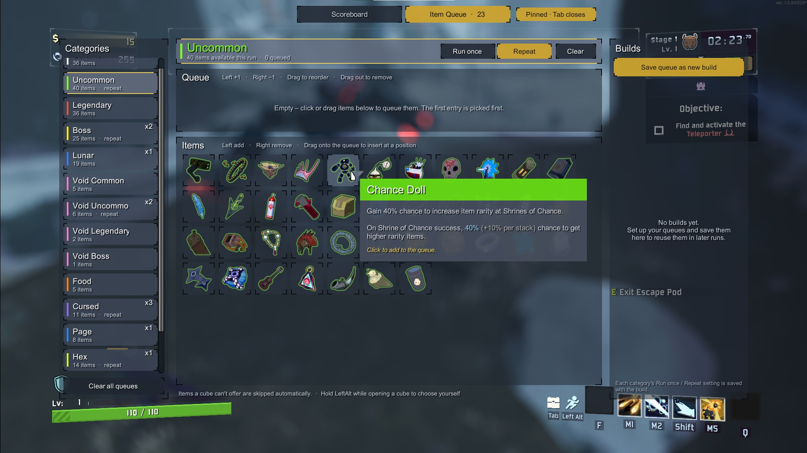

# Command Item Queue

Queue up items for the **Artifact of Command**. When you open a command cube, the next queued item of that tier is picked automatically.

## Features

- **One queue per item tier**: Common, Uncommon, Legendary, Boss, Lunar, Void tiers, equipment and any tier the game adds later (e.g. Hex, Page). Tiers are read from the game data at startup.
- **Run once or Repeat**, set per tier. Every run starts with all tiers on Run once.
- **Builds**: save all queues, including each tier's Run once / Repeat setting, under a name and load them in later runs. One build can be set to load automatically at run start.
- **Built into the Tab scoreboard**, with item icons and the game's item tooltips.
- **Client-side**: only you need the mod. It also works when the host doesn't have it.

## How to use

1. Start a run with the Artifact of Command.
2. Hold **Tab** and click **Item Queue** at the top. Click **Keep open** if you don't want to hold Tab.
3. Pick a tier on the left and click items to add them to its queue.
4. Open a command cube. The next queued item that the cube offers is picked for you.

If no queued item is offered (not unlocked, DLC disabled, queue empty), the normal selection window opens. Hold **Left Alt** while opening a cube to always choose yourself.

### Controls

| Where | Action | Result |
|---|---|---|
| Item list | Left click | Add 1 to the end of the queue |
| Item list | Right click | Remove 1 |
| Item list | Drag onto the queue | Insert at that position |
| Queue | Left / right click | +1 / -1 for that entry |
| Queue | Drag | Change the order |
| Queue | Drag out of the queue, or middle click | Remove the entry |

### Builds

| Button | Result |
|---|---|
| Save queue as new build | Saves all queues and asks for a name |
| Load | Replaces the current queues with the build |
| Update | Overwrites the build with the current queues |
| Rename | Changes the name |
| Auto | Loads this build at the start of every run |
| Delete | Deletes the build (click twice) |

Builds are stored in `BepInEx/config/CommandItemQueue.builds.txt`.

## Configuration

With [Risk Of Options](https://thunderstore.io/package/Rune580/Risk_Of_Options/) installed, all settings can be changed in game under **Settings → Mod Options → CommandItemQueue**. Otherwise edit `BepInEx/config/AllOfThem.CommandItemQueue.cfg`.

| Setting | Default | Description |
|---|---|---|
| KeepQueueBetweenRuns | false | Keep the queues when a new run starts |
| OnlyWithArtifactOfCommand | true | Only show the Item Queue tab when Command is enabled |
| ApplyToVoidPotentials | false | Also auto-pick from Void Potentials |
| ManualPickKey | LeftAlt | Hold while opening a cube to choose yourself |
| DefaultView | RememberLast | View shown when opening the scoreboard |
| SwitchViewKey | none | Optional key to switch between Scoreboard and Item Queue |
| Scale | 1 | Size of the Item Queue window (1 = as large as fits the screen, down to 0.6) |
| ShowUnavailableItems | false | Also list items that can't drop in the current run |
| ShowTooltips | true | Show item tooltips |

## Notes

- Requires only BepInEx. R2API is not needed. Risk Of Options is optional.
- Keyboard and mouse only. Controllers are not supported.

## AI disclosure

The code and the icon of this mod were created with the help of AI. The mod was tested in game.

## Links

- Source and issues: https://github.com/The-regular-Hedgehogs/CommandItemQueue
- Inspired by [CommandQueue](https://thunderstore.io/package/KubeRoot/CommandQueue/) by KubeRoot.
